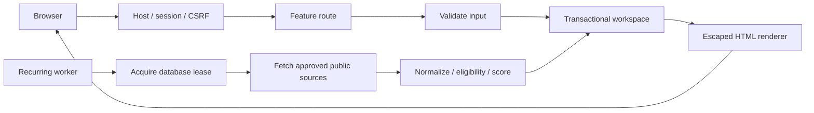

# Following the GrantIQ code

This guide describes the native Node.js application. The older Python code remains under `grantiq/` as a reference; Railway uses `Dockerfile.railway` and never starts the Python server.

## Read these files first

1. `node/server.js`: reads environment variables, opens storage, starts Express and the search worker, and handles shutdown.
2. `node/app.js`: composes security middleware and feature routes. It has no network listener of its own, so tests can create isolated apps.
3. `node/routes/grants.js`: a complete example of reading grants and saving validated pipeline fields.
4. `node/ui/discovery.js`: renders the original dashboard, grant cards and grouped pipeline. All totals come from stored records.
5. `node/discovery.js`: recurring-search lifecycle, database lease, heartbeat, partial results and shutdown.

## File map

```text
railway.json                 Railway build, readiness, restart and always-awake settings
Dockerfile.railway           Linux Node image, public model weights, non-root runtime
node/
  server.js                 Process entry point and graceful shutdown
  app.js                    Middleware and route composition
  config.js                 Environment parsing and fail-closed production checks
  security.js               Host validation, staff sessions and CSRF checks
  routes/
    context.js              Shared render, redirect, grant lookup and fresh scoring
    auth.js                 Healthcheck, login, logout and persistent throttling
    grants.js               Discovery, grant details, pipeline reads and saves
    settings.js             Profile parsing and rescoring
    sources.js              Source approval, manual refresh and schedule controls
    research.js             Staff preferences and research notes
    verification.js         Evidence-backed corrections and withdrawal history
    export.js               Filtered CSV with spreadsheet-formula protection
    overview.js             Public-safe sprint/project explanation
    errors.js               Final not-found/error handlers
  ui/
    html.js                 Escaping, formatting and shared form controls
    icons.js                Original fixed SVG icon vocabulary
    layout.js               Sidebar, organization workspace, topbar and navigation
    discovery.js            Dashboard, real statistics, cards, pipeline and tracking form
    detail.js               Source evidence, score breakdown and review history
    profile.js              Organization settings form
    sources.js              Schedule, approved source form and run activity
    research.js             Research prospect decisions
    verification.js         Typed evidence-review controls
  views.js                  Stable exports for page renderers
  public/
    original.css            Original Python app's monochrome design, formatted for reading
    node.css                Node form/component extensions and responsive adjustments
    node.js                 Live search-status polling using textContent
  discovery.js              Recurring worker and search lease lifecycle
  service.js                Query rotation, upsert, assessment, filtering and status views
  sources.js                Grants.gov and approved-page adapters
  network.js                Public-address checks, pinned DNS, timeouts and response limits
  validation.js             Zod contracts and browser-field conversions
  matching.js               Eligibility gates, scores and evidence revision rules
  embeddings.js             Local CPU MiniLM model loading and visible fallback
  store.js                  PostgreSQL/SQLite transactions and search leases
  scripts/                  Build validation, model/data operations and command-line refresh
  tests/                    Scoring parity, storage, sources, security, HTTP and UI totals
```

## Request and search flow



Routes validate request input before mutation. `store.update` gives the callback a parsed workspace and commits only on success. Source refreshes update source facts while preserving pipeline notes and review history. Reviews record the source revision they were based on; changed or expired evidence needs renewed review.

The scheduler runs in the web process. Its lease prevents simultaneous runs during overlapping deploys, and its heartbeat tells staff whether a worker is available. Railway sleeping is disabled intentionally. A deployment healthcheck verifies database access; it does not prove model readiness or a successful grant search.

## Editing safely

- **UI changes:** start in the matching `ui/` file. Keep route URLs and form field names aligned with `routes/`. Escape all external values through `esc`; only fixed code-owned markup belongs in HTML fragments. `pipelineForm` is shared between detail and pipeline to prevent drift.
- **Scoring changes:** edit `matching.js` or `service.js`, then review parity tests. Do not replace unknown facts with optimistic guesses. Keyword fallback is a reduced scoring mode and must remain visible.
- **Source changes:** adapt `sources.js`, preserving network restrictions in `network.js`. Never bypass login, robots or source approval controls.
- **Data changes:** preserve staff fields and transactional rollback. The current single workspace document serializes writes and can delay requests during a large rescore. Split records into indexed tables before promising high concurrency.
- **Secrets/private documents:** use host variables and private transfers. Do not commit staff notes, funder amounts, research PDFs or database snapshots. The Railway Dockerfile copies only public application paths.

## Checks

```sh
npm ci
npm run build
npm test
docker build -f Dockerfile.railway -t grantiq-railway:local .
```

The build command checks syntax and runtime imports; the Docker build additionally verifies Linux dependencies and MiniLM loading. GitHub Actions supplies a disposable PostgreSQL database for the conditional integration test. Never point `GRANTIQ_TEST_POSTGRES_URL` at a real staff database: that test resets its workspace table.

For browser review, check dashboard, pipeline, sources, profile and grant detail on desktop and mobile; save a pipeline note, filter grants and verify the schedule monitor. Use a separate fixture workspace for tests. Start the actual app with `npm start` only after verifying its storage variables.

Deployment instructions and remaining acceptance checks are in `RAILWAY.md`. The shared staff password is still the MVP access model; individual application accounts and roles are not implemented by this refactor.
