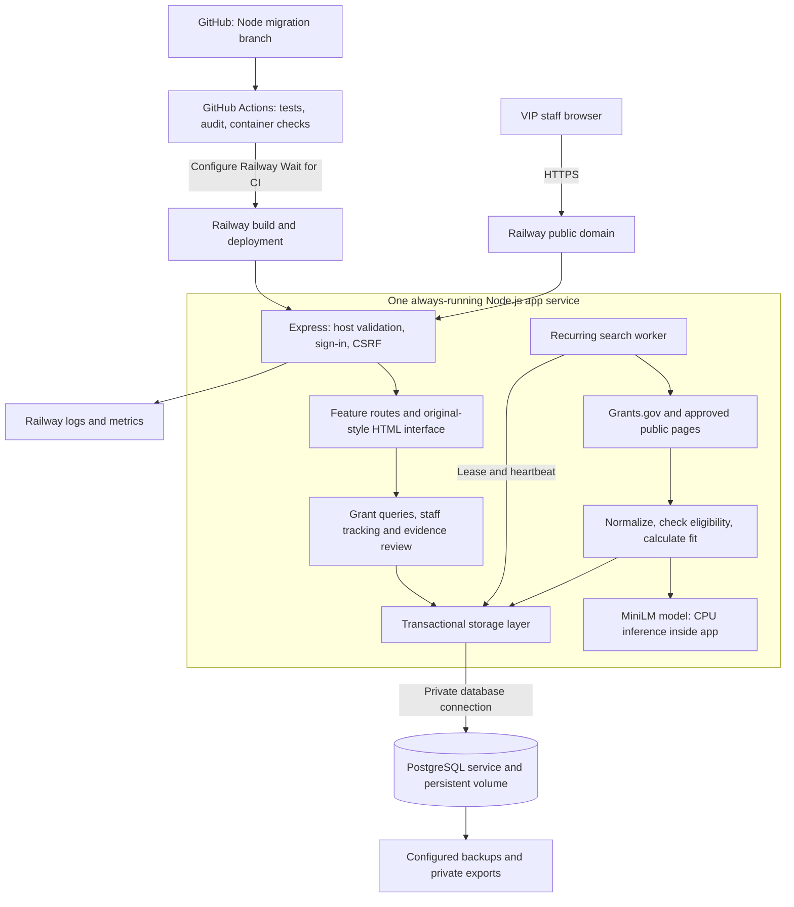

# GrantIQ system architecture

Updated November 2, 2026. This is the intended Railway deployment. The container has passed Linux CI previously; a live account deployment is separate and is currently blocked by the user's Railway trial restriction.

## Two services, no separate AI subscription

**App service:** Node.js/Express serves the interface and handles forms, authentication and the embedded recurring-search worker. The original-style sidebar and grant/pipeline pages are server-rendered HTML; there is no separate frontend deployment. Small browser JavaScript polls search status.

**Database service:** PostgreSQL stores the organization profile, grants, staff pipeline, evidence reviews, research preferences, sources and search activity. Its persistent volume outlives an app deployment. The app's disposable filesystem must not hold staff data. The current MVP stores one transactional JSONB workspace document, not separate indexed tables per grant.

**Matching model:** MiniLM runs inside the app on CPU through Transformers.js. Public model weights are included in the container image. There is no separate AI server or paid AI API. If model loading fails, the UI discloses reduced keyword scoring; the healthcheck alone does not verify semantic matching.

## What happens during a grant search

1. A staff request or the timer asks the worker to run.
2. A database-backed lease prevents two deployments from running the same search concurrently.
3. The worker rotates search terms and fetches Grants.gov details or individually approved public funding pages. Network checks reject private addresses and respect access restrictions.
4. Records are normalized and validated; missing facts remain unknown. Eligibility gates run before fit scoring.
5. Refreshes update source facts while preserving staff tracking and review history. Run counts, partial failures and the next search time are saved.
6. Staff review scores and evidence, then move grants through pipeline stages. GrantIQ does not submit applications automatically.

## Deployment and security boundaries

- `railway.json` selects `Dockerfile.railway`, readiness route `/health`, one replica and no sleeping. These settings keep the embedded scheduler available, but outages and exhausted account limits can still interrupt searches.
- Configure Railway's **Wait for CI** before enabling automatic production deployment. GitHub checks do not enable this dashboard setting themselves.
- `config.js` accepts `DATABASE_URL` or the existing GrantIQ-specific override, learns the Railway public domain from environment variables and fails closed if required secrets/database/domain are absent. Hostnames are never trusted from an incoming request.
- Secrets live in Railway variables, not the public repository. Private research documents and database snapshots remain excluded from the container.
- `/health` verifies storage access. Production cookies are secure, and forms require CSRF protection. The current shared-password model does not provide individual staff accounts, roles or per-user audit records.
- Enable database backups, test restore into a separate environment, and keep private exports under VIP ownership. A code rollback does not restore database contents.
- A technical maintainer still handles dependency updates, source changes and incidents. VIP should own billing, hosting, domain and code access before handoff.

## Where to follow the code

| Layer | Entry point |
| --- | --- |
| Startup and shutdown | `node/server.js` |
| Environment and setup checks | `node/config.js`, `node/scripts/check-config.js` |
| Request/security composition | `node/app.js`, `node/security.js` |
| HTTP features | `node/routes/` |
| Original-style interface | `node/ui/`, `node/public/` |
| Search orchestration | `node/discovery.js` |
| Collection and network restrictions | `node/sources.js`, `node/network.js` |
| Scoring and model | `node/matching.js`, `node/embeddings.js` |
| Transactions and leases | `node/store.js` |

See [CODE-GUIDE.md](CODE-GUIDE.md) for the complete file map and [RAILWAY.md](RAILWAY.md) for deployment steps. Before launch, verify HTTPS login, saves after redeploy, model readiness, an unattended search and backup restoration on the actual Railway account. Long rescoring currently serializes writes; higher concurrency needs a database design change, not just more RAM.
